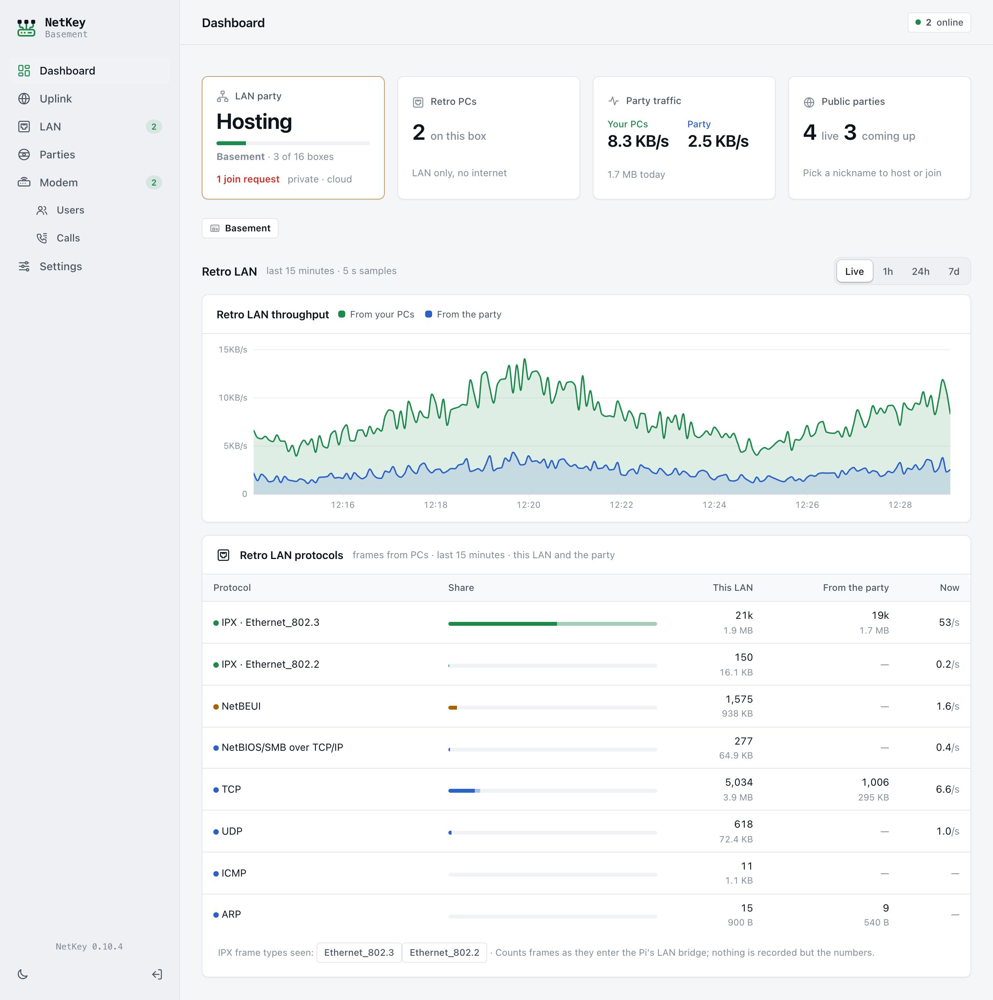

# NetKey

**LAN parties with your old PCs, over the internet, the way they used to be.**

Remember hauling a beige tower and a CRT to a friend's house, running cables across the floor and spending the
first hour getting the network up? The games were worth it. Most of them still are. The trouble is that your friends now
live in other cities, and games like Duke Nukem 3D, Warcraft II, Command & Conquer and the original Diablo only
know how to find each other on a local network. They've never heard of the internet.

NetKey fixes that. It's a small box (running on a Raspberry Pi) that you plug your old PC into. Your friends do the same at
their place. One of you starts a party, sends the others a code, and every old PC ends up on the same network, as if
you were all sitting in the same room again.

## How it works for you

1. **Set up the box once.** Put Raspberry Pi OS on a memory card, paste one command, done.
   [INSTALL.md](INSTALL.md) walks you through it step by step, no experience needed.
2. **Plug in your old PC.** It gets a network address by itself, just like at a real LAN party.
3. **Host or join a party.** Click *Host a party*, send your friends the invite code, approve them when they show up.
4. **Play.** Start the game, choose network play, and your friends' PCs are right there.

No router settings, no port forwarding, no VPN accounts. It works from behind any normal home internet connection.

## Why it actually works with old games

Most "play old games online" tricks only pass along modern internet traffic. Old games often speak older languages:
**IPX**, **NetBEUI**, NetBIOS. NetKey doesn't try to translate. It connects the networks at the level of the cable
itself, so whatever your 1997 PC sends arrives on your friend's PC exactly as if a long network cable ran between
your houses. IPX, NetBEUI and TCP/IP all just work, and so does browsing each other's shared folders in Network
Neighborhood.

Classic Macs are welcome too. Their network language, **AppleTalk**, travels the same way, so Marathon, Bolo and
other Mac network games find each other across the party, from one Mac with Ethernet to another.

The connection between boxes is encrypted from end to end. Relays help your traffic across the internet and your
party picks the one with the lowest delay automatically.

## What you get

- **Private parties:** start one, share the invite code, approve who gets in. Up to 16 boxes.
- **Public parties:** a list of parties anyone with a NetKey can browse and ask to join. Plan events ahead of time,
  RSVP, vote for games and chat with the other players. Be part of the community.
- **A shared folder for every old machine:** Windows file sharing (Network Neighborhood, Windows for Workgroups
  to XP), Mac file sharing for Mac OS 7.6 to 9 and Mac OS X (Mac programs keep their resource forks), FTP, and a plain
  web page any old browser can read. Drop files in from your phone or computer.
- **Your old PC stays separated** from your home network: it can't see your laptop or your files. You can let it
  online if you want to.
- **Easy administration** to run everything from your phone or computer: who's connected, which games are on, how
  good the connection is.

## What you need

- A Raspberry Pi (any old works but a Pi 3, 4 or 5 is best), a microSD card and a USB network adapter
- An old PC with a network card: DOS, Windows 95, 98 or XP. Or a Mac with Ethernet: Mac OS 7.6 to 9, or Mac OS X
- A friend with the same setup. That's the whole point, after all.

**Get started: [INSTALL.md](INSTALL.md).**

## Also in the box

NetKey began as a dial-up modem emulator: an old PC with only a serial port can "dial up" through the Pi and get
online, modem screech optional. That still works, and you'll find it under *Modem* in the web page.

**Phone numbers.** Every box can get its own number, like `555-3870`. A machine on a serial line dials a friend's
box with `ATDT5553870`, the friend's machine hears `RING` and answers, and both get `CONNECT`: a null-modem cable
across the internet. That's online play for serial and modem games on the Amiga, the Atari ST and DOS. Incoming calls
are off until you switch them on, you choose who may call (your phone book, or anyone with your number), and the
box is busy while it's in a LAN party. Two lines on the same box call each other without a number: dial `555-0100`
for line 0, `555-0101` for line 1. Calls run through the same relays as parties, encrypted from box to box.

## Under the hood

Built on proven, standard technology, not clever hacks:

- **A real Layer 2 network**, not a translator. Full-size Ethernet frames arrive untouched, which is why IPX,
  NetBEUI and AppleTalk games just work. Transported with VXLAN over VPN.
- **Standard file servers** on the retro LAN only: Samba (SMB1 for the old Windows versions), netatalk (AFP over
  TCP/IP for Macs), FTP and HTTP. They never show up on your home network.
- **End-to-end encrypted with VPN**, built into the Linux kernel. Our servers pass the
  traffic along but can't read it as its encrypted end to end.
- **Works on any home connection**, including the awkward ones (CGNAT, DS-Lite, mobile networks), with no router
  setup and no fragmented packets getting lost on the way.
- **Your home network stays private.** The party runs in its own isolated network, behind its own firewall.
- **Relay servers in several regions.** Your party picks the fastest one automatically. If a server goes down, the
  party moves to another in seconds, without anyone having to rejoin.

## For developers

The code that runs on the Pi: `install.sh` and `uninstall.sh`, the `netkey/` Python package and `modem.py`, the web
page in `web/`, and the system configuration in `systemd/`, `nft/`, `udev/`, `ppp/`, `sysctl/` and `config/`.
`get.sh` is the one-line installer that downloads the latest release.

## License and commercial use

NetKey is free for personal and other noncommercial use under the
[PolyForm Noncommercial License 1.0.0](LICENSE): use it at home, at your LAN-party club, in a school or a charity etc.

**Commercial use needs a separate license.** That includes selling NetKey boxes, running paid events with it, or
building it into a product or service. Get in touch at **[support@netkey.no](mailto:support@netkey.no)** and we'll work something out.

NetKey's cloud service (the hub and relay servers behind cloud parties) is not part of this repository.

**What the box tells the cloud hub about itself:** while you use its web page, the box asks the hub every few hours
whether a newer NetKey is out. That question carries the box's ID, its name, its NetKey version and its hardware (Raspberry Pi
model, operating system, processor type, memory size, and which chip the retro LAN adapter has). The hub keeps them
to count how many boxes are in use and on what. Nothing about your PCs, files or games is sent.

**Phone numbers and calls:** a box with a number tells the hub who may call it (off, anyone, or the numbers in its
phone book; never names) and whether it can take a call right now. For each call between boxes the hub sees which
two boxes, when and for how long, and keeps that for 30 days against abuse. It never sees what is sent, and the
called box is never told who is calling (no caller ID).
